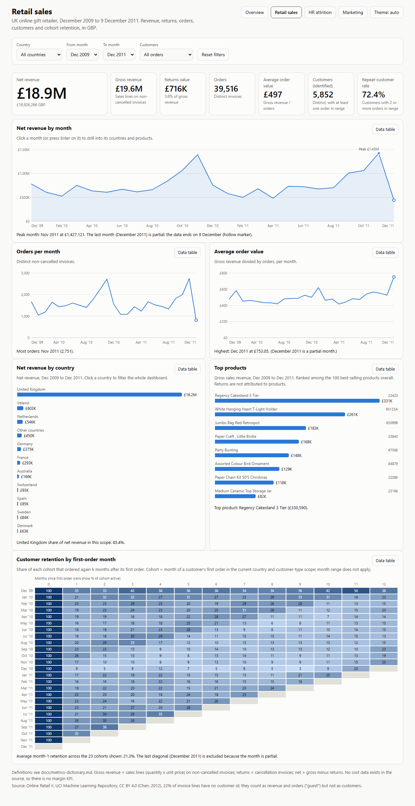
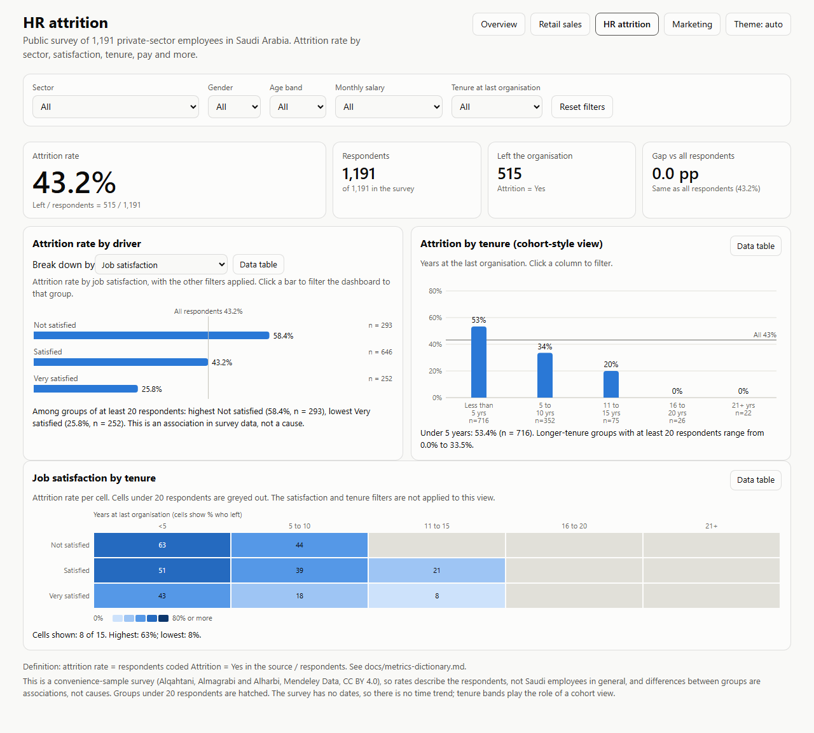
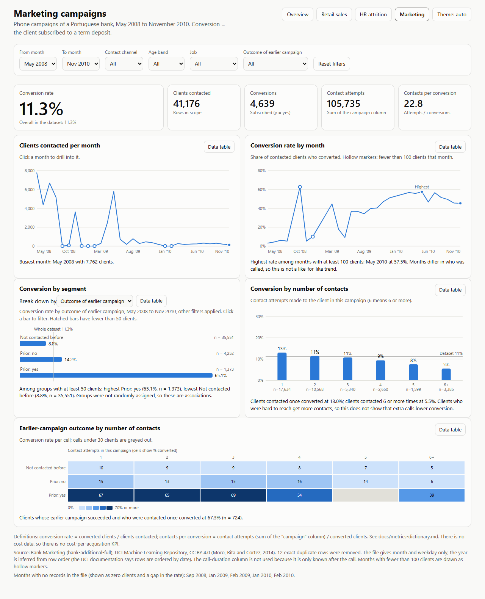
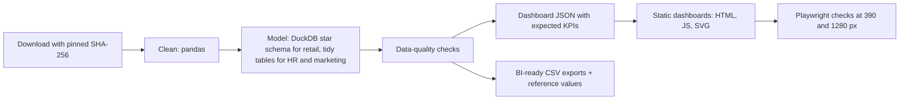

# Analytics dashboards: retail, HR and marketing KPIs on public data, built with open tools

[](https://creativecommons.org/licenses/by-nc-nd/4.0/)

## Overview

Three static, interactive dashboards (retail sales, HR attrition, marketing campaigns) built from three public,
CC BY 4.0 datasets. A tested pandas and DuckDB pipeline cleans the data, models it, runs data-quality checks and
writes the numbers the dashboards load. Each dashboard has KPI tiles, filters, drill-downs, a trend or cohort view,
a colour-blind-safe palette, keyboard operation and a data table behind every chart.

**The dashboards in this repository are open-tool implementations** (plain HTML, JavaScript and SVG, no server).
**Tableau Public and Power BI Desktop versions are not included.** What is included for building them is a step-by-step
guide with matching calculated fields and DAX measures ([docs/build-in-bi-tools.md](docs/build-in-bi-tools.md)),
cleaned CSV exports generated by a script, and reference values to check a rebuilt workbook against
([docs/bi-reference-values.md](docs/bi-reference-values.md)).

## Summary

| Dashboard | Dataset | KPIs | Screenshot (1280 px) |
|---|---|---|---|
| [Retail sales](docs/retail.html) | Online Retail II, UCI, 2009-2011, 1.07M invoice lines | net revenue, returns, orders, average order value, customers, repeat-customer rate, cohort retention | <a href="docs/screenshots/retail-1280.png"></a> |
| [HR attrition](docs/hr.html) | Saudi Employee Attrition survey, Mendeley Data, 1,191 respondents | attrition rate, respondents, leavers, gap versus all respondents | <a href="docs/screenshots/hr-1280.png"></a> |
| [Marketing campaigns](docs/marketing.html) | Bank Marketing (bank-additional-full), UCI, 41,176 clients | conversion rate, clients contacted, contact attempts, contacts per conversion | <a href="docs/screenshots/marketing-1280.png"></a> |

Phone-width (390 px) screenshots are in `docs/screenshots/`. KPI definitions are in
[docs/metrics-dictionary.md](docs/metrics-dictionary.md); the retail star schema is in
[docs/data-model.md](docs/data-model.md).

## Demo

The dashboards are live at https://janeferdinant.github.io/analytics-dashboards/ (GitHub Pages). To view them locally:

```bash
python -m http.server 8000 --directory docs
```

then open <http://localhost:8000/>. The pages load `docs/data/*.json` with `fetch`, so they need an HTTP server
(opening the HTML file directly shows a message that explains this).

## Problem statement

Business teams ask the same questions of different data: how much did we earn and what came back, who stays and who
leaves, which campaigns convert. Answering them well needs precise metric definitions, data that has been checked,
and views that let a reader filter and drill down without being misled by small groups or partial months. This
project shows that workflow end to end on public data.

## Approach



- **Retail** is cleaned in pandas (`retail.py`) and modelled in DuckDB SQL (`src/analytics_dashboards/sql/retail_star.sql`,
  KPI queries in `retail_kpis.sql`): one fact table at invoice-line grain, one at invoice grain, four dimensions.
- **HR** and **marketing** are single-grain tables, so they are tidy tables rather than forced star schemas.
- **Dashboards** compute every KPI in the browser from compact columnar JSON, so filters are exact. The pipeline writes an
  `expected` block next to the data and the browser tests compare the rendered numbers with it.
- **Chart design** follows a documented method: form chosen by the data's job, one blue hue for magnitude, blue and
  orange (validated for colour-vision deficiency) when two series are needed, no dual axes, a legend and data table,
  hatched groups where the sample is small.

## Data

Downloaded at run time, checksum-verified, never committed. Details and attribution: [THIRD_PARTY_NOTICES.md](THIRD_PARTY_NOTICES.md).

| Dataset | Source | Size used | License |
|---|---|---|---|
| Online Retail II | [UCI](https://archive.ics.uci.edu/dataset/502/online+retail+ii), Chen (2012), [DOI](https://doi.org/10.24432/C5CG6D) | 1,067,371 rows, 2009-12-01 to 2011-12-09 | CC BY 4.0 |
| Bank Marketing (bank-additional-full) | [UCI](https://archive.ics.uci.edu/dataset/222/bank+marketing), Moro, Rita and Cortez (2014), [DOI](https://doi.org/10.24432/C5K306) | 41,188 rows (41,176 after removing 12 duplicates) | CC BY 4.0 |
| Saudi Employee Attrition Dataset | [Mendeley Data](https://data.mendeley.com/datasets/6z2hty8php/1), Alqahtani, Almagrabi and Alharbi (2025), [DOI](https://doi.org/10.17632/6z2hty8php.1) | 1,191 survey rows | CC BY 4.0 |

All three datasets are public and need no login. The derived `docs/data/*.json` files (about 1 MB, 0.04 MB and
0.8 MB) are committed; raw data and `exports/` are not. The HR file is a survey (a convenience sample), the marketing
file has month but no year (the year is inferred from row order), and the retail file has no cost data: see Limitations.

## Results

Everything below was produced by the committed pipeline on 2026-10-15 (log: [docs/runs/2026-10-15-pipeline.md](docs/runs/2026-10-15-pipeline.md))
and re-computed independently from the exported CSVs ([docs/bi-reference-values.md](docs/bi-reference-values.md)). The browser
tests confirmed that each dashboard shows the same numbers (log: [docs/runs/2026-10-15-verification.md](docs/runs/2026-10-15-verification.md)).
These are descriptive figures about these datasets, not claims about other businesses.

| Measure | Value | Status | How measured | Date |
|---|---|---|---|---|
| Retail rows kept after cleaning | 1,021,128 of 1,067,371 (removed: 34,335 duplicates, 5,980 non-product codes, 5,928 price <= 0) | Verified | `clean()` row counts in the run log | 2026-10-15 |
| Retail net revenue | 18,926,266.18 GBP (gross 19,642,692.15; returns 716,425.97, 3.6%) | Verified | DuckDB SQL; reproduced with pandas from the CSV export and in the browser | 2026-10-15 |
| Retail orders, average order value | 39,516 orders; 497.08 GBP | Verified | same | 2026-10-15 |
| Retail identified customers, repeat rate | 5,852 customers; 72.35% placed 2 or more orders | Verified | same | 2026-10-15 |
| HR attrition rate | 43.24% (515 of 1,191 respondents); 58.4% among "Not satisfied" (n = 293), 25.8% among "Very satisfied" (n = 252) | Verified | pandas and browser | 2026-10-15 |
| HR attrition by tenure | 53.4% under 5 years (n = 716); 33.5% at 5 to 10 years (n = 352) | Verified | browser tenure view | 2026-10-15 |
| Marketing conversion rate | 11.27% (4,639 of 41,176 clients); 65.1% where an earlier campaign succeeded (n = 1,373) versus 8.8% for clients not contacted before (n = 35,551) | Verified | pandas and browser | 2026-10-15 |
| Marketing contacts per conversion | 22.79 (105,735 attempts / 4,639 conversions) | Verified | pandas and browser | 2026-10-15 |
| Data-quality checks | 33 of 33 pass (retail 12, HR 8, marketing 13) | Verified | `quality.py`, run log | 2026-10-15 |
| Tests | 30 fast tests, 5 real-data tests, 21 browser checks (plus 6 screenshot captures) | Verified | pytest, [verification log](docs/runs/2026-10-15-verification.md) | 2026-10-15 |

A data-quality finding worth knowing: in the marketing file, 4,110 clients with earlier contacts also have `pdays = 999`
(the value documented as "not previously contacted"). The dashboards therefore flag prior contact with `previous > 0`
and never use `pdays`.

## Tech stack

Python 3.10+, pandas, DuckDB (SQL), openpyxl, pytest, Ruff, Playwright (browser checks only), plain HTML, CSS,
JavaScript and SVG for the dashboards (no third-party JavaScript or fonts), GitHub Actions (lint and fast tests only).

## Getting started

Prerequisites: Python 3.10 or newer, about 250 MB of free disk space (109 MB of downloaded data and 78 MB of exports), and a few minutes
(download about 15 seconds; `build` took 3 minutes 18 seconds on an 8-core desktop CPU, mostly reading the retail workbook). `make` targets in the `Makefile` are shortcuts for
the commands below.

```bash
git clone https://github.com/Janeferdinant/analytics-dashboards.git
cd analytics-dashboards
python -m venv .venv
source .venv/bin/activate          # Windows: .venv\Scripts\activate
python -m pip install -r requirements.txt -e .
python -m analytics_dashboards.cli download
python -m analytics_dashboards.cli build
```

`build` cleans and models the data, runs the 33 data-quality checks (exit code 1 if any fails), rewrites
`docs/data/*.json`, writes a dated log to `docs/runs/`, and writes the BI exports to `exports/` and
`docs/bi-reference-values.md`. Expected ending: `Failed checks: 0`.

Tests and lint:

```bash
python -m ruff check .
python -m ruff format --check .
python -m pytest -q                              # fast tests, no downloads
python -m pytest -q -m data -o addopts=""        # checks on the real data (needs the download)
python -m pip install playwright
python -m playwright install chromium
python -m pytest -q -m e2e -o addopts="" tests/e2e   # browser checks at 390 and 1280 px
```

To rebuild the dashboards in a BI tool, follow [docs/build-in-bi-tools.md](docs/build-in-bi-tools.md) after `build`.

## Project structure

```
src/analytics_dashboards/   download, cleaning (retail, hr, marketing), quality checks, exports, dashboard JSON, CLI
src/analytics_dashboards/sql/   retail_star.sql (star schema), retail_kpis.sql (KPI queries)
tests/                      fast unit tests, real-data tests (marker "data"), tests/e2e browser tests (marker "e2e")
docs/                       index.html, retail.html, hr.html, marketing.html, assets/ (dash.js, dash.css), data/ (JSON)
docs/metrics-dictionary.md  KPI definitions
docs/data-model.md          star schema and tidy tables
docs/build-in-bi-tools.md   step-by-step guide for Tableau Public and Power BI Desktop
docs/bi-reference-values.md numbers a rebuilt workbook should show (generated)
docs/runs/                  dated pipeline and verification logs
docs/screenshots/           390 px and 1280 px screenshots
```

## Real-world applications

- **Retail:** a weekly revenue, returns and repeat-purchase review for an online shop; the cohort view shows how much of
  each month's new customers come back, which informs retention budgets.
- **HR:** a people-analytics view for an HR business partner exploring which groups report leaving, with small-group
  warnings so thin segments are not over-read.
- **Marketing:** a campaign review that separates reach (clients contacted) from conversion and from effort (attempts per
  conversion), including the effect of earlier-campaign outcomes.

## Limitations

- These are descriptive dashboards on public data. They do not predict anything, and group differences are associations,
  not causes. No models, tests of significance or confidence intervals are reported.
- **Retail** has no cost data, so there is no margin or profit KPI. Guest lines (no customer id, about 22% of lines) count in
  revenue and orders but not in customer metrics. December 2011 is a partial month (data ends 9 December) and is marked or
  excluded. Returns are dated by the cancellation invoice and are not attributed to products. The open dashboard recomputes
  cohorts inside the current filters; the BI-tool guide uses the first order in the whole dataset, so the two can differ when a
  country filter is on.
- **HR** is a survey of 1,191 volunteers in one country, not a workforce census; the attrition share is a survey proportion, not an annual turnover rate, and the survey has no dates, so tenure bands stand in for a cohort view and there is no time trend.
- **Marketing** has month but no year; the year is inferred from row order (the inference is tested: the timeline starts May 2008
  and ends November 2010 as documented) and several calendar months have no rows, shown as gaps. Months with under 100 clients
  are drawn hollow. There is no cost data, so no cost per acquisition. The call-duration column is excluded because it is only known after the call.
- Browser checks used Chromium only. The dashboards were checked with keyboard-driven tests and colour-contrast calculations,
  not with a screen reader or an automated accessibility auditor.
- No Tableau or Power BI files exist in this repository.

## Future scope

- Build and publish the Tableau Public and Power BI Desktop versions from the guide (owner task), and add their links.
- Add a marketing-mix or lift analysis with confidence intervals if a dataset with randomised assignment is found.
- Add a customer lifetime value and RFM segmentation view for the retail data, with the cohort definition made identical in the
  open and BI versions.
- Add an automated accessibility audit and a Firefox and WebKit run to the browser checks.

## Credits & citation

Datasets: see [THIRD_PARTY_NOTICES.md](THIRD_PARTY_NOTICES.md) for the required attribution and changes made. To cite this
repository: Ferdinant, J. R. (2026). *Analytics dashboards* [Software]. GitHub, Janeferdinant/analytics-dashboards.

## License

Original work © Jane Rose Ferdinant, licensed CC BY-NC-ND 4.0 (see [LICENSE](LICENSE)). Third-party components retain their own
licenses; see [THIRD_PARTY_NOTICES.md](THIRD_PARTY_NOTICES.md).

## Author

Jane Rose Ferdinant: [portfolio](https://janeferdinant.vercel.app) | [LinkedIn](https://www.linkedin.com/in/janerosenf/)
