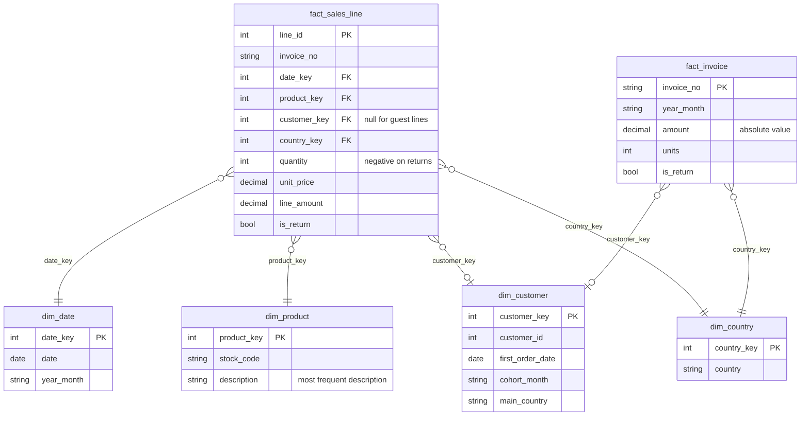

# Data model

## Retail: star schema (DuckDB, `src/analytics_dashboards/sql/retail_star.sql`)

- `fact_sales_line` grain: one invoice line. `fact_invoice` grain: one invoice (orders, AOV, retention).
- A missing customer id is kept as a null `customer_key`, so revenue reconciles to the cleaned lines.
- KPI queries live in `sql/retail_kpis.sql` (`monthly_kpis`, `repeat_customer_rate`, `cohort_retention`).
- Data-quality checks (`src/analytics_dashboards/quality.py`) test key uniqueness, null rules, sign rules, orphan keys,
  reconciliation of the fact tables to the cleaned lines, and that no order precedes its customer's cohort month.
  Their results are in `docs/runs/`.

## HR: one tidy table (pandas, `hr.py`)

One row per respondent (`hr_tidy.csv`): `respondent_id`, `attrition`, `left` (0/1), demographics, pay and
tenure bands, and ordered satisfaction and working-condition columns. No joins are needed, so no star schema is
forced onto a single-grain survey.

## Marketing: one tidy table (pandas, `marketing.py`)

One row per client (`marketing_tidy.csv`): demographics, contact details, `converted` (0/1), `campaign` (contact
attempts), `prior_outcome`, `year_month` (year inferred from row order) and macroeconomic columns from the source.

## What the dashboards load

`docs/data/*.json` hold compact columnar tables (small integer codes plus level names) and an `expected` block
with the pipeline's own KPI values. The pages recompute every number in the browser, so filters are exact, and
the browser tests compare the page's numbers with `expected`.
